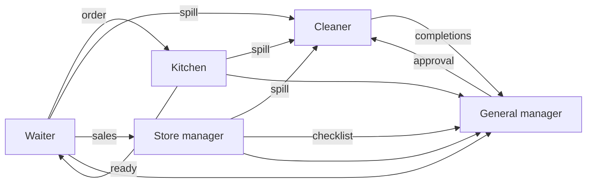

# Mavera — Restaurant Operations System

**One-page spec** · Frontend AI Engineering capstone · Sinem Doğan

---

## Problem

Restaurant staff work from disconnected tools: paper tickets to the kitchen, a clipboard for cleaning, a spreadsheet for stock, and a monthly report the owner skims and forgets. Information doesn't move between roles, so a spill reported by a waiter never reaches the cleaner, a dish that's about to run out surprises the kitchen mid-service, and management sees problems weeks after they happened.

Mavera is a five-location restaurant group. This system gives each role one screen built for what they actually do in the moment, and connects those screens so the work of one role becomes information for another.

## Users

| Role | Where they are | What they need |
|---|---|---|
| **Waiter** | On the floor, moving, one hand free | Speed. See table status, take an order in seconds, know when food is ready. |
| **Kitchen (expo)** | At the pass, hands busy, screen at arm's length | Readability. What to cook, in what order, what's running late, what's an allergy. |
| **Cleaner** | Moving between areas | Clarity. What's urgent right now, what's due today, what's overdue. |
| **Store manager** | Office, back of house | Control. What's below par, what's being wasted, what to order. |
| **General manager** | Anywhere, across five locations | Decisions. Not charts — what to do today, and where. |

Four roles are scoped to one location. Only the general manager sees all five. A person's role and location come from their **account**: they sign in with an email and password, and the API decides what they may see. A waiter at Kadıköy never sees Bebek's data, and the URL carries no location for those four roles.

## Core flows

1. Waiter seats a table (enters covers) → takes the order → sends it → kitchen ticket appears
2. Expo cooks and marks ready → waiter is notified → runs food → closes the table
3. Waiter, kitchen, or store manager reports a spill → it appears at the top of the cleaner's queue
4. Store manager edits the daily cleaning checklist → GM approves → it becomes the cleaner's list
5. Sales generate theoretical ingredient usage → store manager counts actual stock → variance surfaces waste
6. Everything above feeds the GM's analytics and AI briefing

## Screens

### Landing
Five role buttons with icons, no authentication. Dark, warm, high-end feel. A note marks this as demo mode.

### Waiter
| Screen | Purpose |
|---|---|
| **Floor plan** | Tables as tiles across three section tabs (Main / Terrace / Family), colour-coded: free, seated, ordered, ready, check requested. Header holds notifications and the report-spill button. |
| **Order** | Menu categories, item grid, and a receipt-styled ticket panel. Quantity steppers, modifier chips, urgency flags (allergy / rush / VIP / large party). Unsent items shown in amber. |
| **Ticket detail** | A sent order: what's fired, what's ready, add more, request check, close table. |

### Kitchen (expo)
| Screen | Purpose |
|---|---|
| **Ticket rail** | One card per order, sorted by age. Elapsed timer runs green → amber → red. Station tabs (All / Grill / Cold / Dessert) filter the rail and emphasise that station's items while dimming the rest — every station sees the whole ticket so plates go out together. Allergens and urgency flags highlighted. Actions: start → ready → bump. |

### Cleaner
| Screen | Purpose |
|---|---|
| **Task queue** | Urgent spills on top: what, where, who reported it, how long ago. Below, today's approved checklist grouped by area (Main, Terrace, Family, Kitchen, Restrooms, Storage, Entrance) with due times; overdue flagged red. Completion records timestamp and name. |

### Store manager
| Screen | Purpose |
|---|---|
| **Stock** | ~20 key ingredients with current quantity, par level, reorder point, status. Below-par pinned to top. |
| **Counts** | Weekly physical count entry and history. |
| **Movements** | Every stock change with a reason: received, used, wasted, transferred, staff meal. |
| **Variance** | Theoretical usage (derived from sales) vs. actual (derived from counts). The gap is waste, over-portioning, or error. |
| **Checklist editor** | Add, edit, remove daily cleaning tasks. Submits a new version for GM approval. |

### General manager
| Screen | Purpose |
|---|---|
| **Overview** | AI briefing pinned at top. KPI row: revenue, covers, average spend per cover, average ticket time, waste %, cleaning compliance. Comparison of all five locations. |
| **Location detail** | One location in depth: trends, top and bottom menu items, prep time distribution, hourly patterns. |
| **Approvals** | Pending cleaning checklists from all five store managers. Approve or reject with a note. |

### Routes

Fourteen routes: landing plus thirteen role screens. Tabs (floor plan sections, kitchen stations) are query parameters on one route, not separate routes.

| Route | Screen |
|---|---|
| `/` | Landing |
| `/waiter/floor-plan?section=main\|terrace\|family` | Floor plan |
| `/waiter/order/[tableId]` | Order |
| `/waiter/ticket/[ticketId]` | Ticket detail |
| `/kitchen?station=all\|grill\|cold\|dessert` | Ticket rail |
| `/cleaner` | Task queue |
| `/store/stock` · `/store/counts` · `/store/movements` · `/store/variance` · `/store/checklist` | Store manager screens |
| `/gm` | Overview |
| `/gm/locations/[locationId]` | Location detail — the only route that takes a location in the URL |
| `/gm/approvals` | Approvals |

`/waiter` and `/store` redirect to their first screen.

## Data

Everything lives in **PostgreSQL**, reached only through the NestJS API (via Prisma). A seed script fills the database.

**Seeded** (generated once with a fixed seed, then loaded into the database):
locations (5, with staff and table layouts) · menu items (32, each tagged to a station) · ingredients (22 key items) · recipe lines (76) · 10 weeks of history per location — daily sales aggregates, weekly stock counts and movements, daily cleaning records. History is aggregated rather than stored as individual orders; the screens only need daily totals.

**Live** (created while people use the app, stored in the same database):
user accounts, today's tables, orders, tickets, spill reports, task completions, checklist versions. Screens refresh from the API every few seconds, so one person's action shows up on another person's screen.

Deliberate patterns are baked into the seed data — weekend rushes, one underperforming location, a slow-prep dish — so the AI has something real to find. Re-running the seed script restores the clean state.

### Entities

- **Location** — id, name, staff, sections, table layout
- **MenuItem** — id, name, category, price, station, allergens, prep minutes
- **Ingredient** — id, name, unit, cost per unit, par level, reorder point. Current quantity per location is the latest stock count, not a stored field
- **RecipeLine** — menu item, ingredient, quantity
- **Table** — id, section, seats, status, covers, current order
- **Order** — id, table, items with modifiers, urgency flags, timestamps, total
- **Ticket** — order reference, station states, started/ready/bumped timestamps
- **StockCount** — ingredient, counted quantity, date, by whom
- **StockMovement** — ingredient, quantity (signed: positive in, negative out), reason, timestamp, optional note
- **CleaningTask** — area, description, due time, frequency
- **ChecklistVersion** — tasks, submitted by, status, approved by, note
- **TaskCompletion** — task, timestamp, by whom
- **SpillReport** — area, description, reported by, timestamp, resolved

## AI features

One NestJS endpoint (`api/`, route `POST /ai/chat`) streams from Claude and exposes three tools. The Claude API key lives only in the API's environment and never reaches the browser.

| Role | Tool | Returns | Why AI |
|---|---|---|---|
| **Kitchen** | Prioritise queue | `{ ticketId, position, reason, estimatedReady, riskOfDelay }` | Weighing cook times, ticket age, and urgency flags against each other is judgement, not a sort. Output renders as a reordered rail with a one-line justification per card. |
| **Store manager** | Run-out projection | `{ item, projectedRunOut, affectedMenuItems[], suggestedAction }` | Connecting a depleting ingredient to the dishes it kills requires reasoning across recipes and sales trends. Renders as cards, not text. |
| **General manager** | Shift briefing | `{ headline, actions: [{ action, reason, urgency }], watchItems[], comparison }` | The point is a decision, not a summary. Dashboards get admired for a month and then ignored; "prep 40 more portions, Bebek is short on lamb by Thursday" does not. |

The waiter has no AI, deliberately. Mid-service, a waiter needs predictable speed, not a model interpreting them.

Every tool state is designed: input streaming, input available, output available, output error. Failure shows a designed error state with a working retry.

## Responsive strategy

Mavera is a workplace tool. Kitchen displays, floor plans, and five-location dashboards are tablet-and-desktop experiences — real POS systems are built the same way. The system scales fluidly across desktop sizes and shows a designed message below tablet width rather than a broken layout.

| Range | Behaviour |
|---|---|
| **< 1024px** | Designed below-breakpoint state: full-screen message explaining Mavera is built for tablet and desktop. Not an error, not a broken layout. The AI chat panel remains usable here. |
| **1024–1279px** | Tablet landscape. Single-column dashboards, floor plan reflows to fewer columns, sidebars collapse to icons. |
| **1280–1599px** | Baseline desktop. The size everything is designed at. |
| **1600–1919px** | Wider gutters, more grid columns, charts gain breathing room. |
| **≥ 1920px** | Content capped at a max width and centred so table rows and dashboard cards stay readable. |

**How it's built**
- CSS Grid with `repeat(auto-fit, minmax(...))` for the floor plan, ticket rail, and KPI cards — tiles reflow by available space, not by breakpoint
- `clamp()` for type scale and spacing so text grows smoothly between sizes instead of jumping
- Fractional and percentage columns rather than fixed-pixel sidebars
- A `max-width` container on the GM dashboard so wide monitors don't stretch rows past readability
- Kitchen ticket type sized for arm's-length reading at every width

**Tested at** 1024, 1280, 1440, 1920, 2560.

**Note on phones.** The dense operational screens are deliberately not designed for phones; below 1024px they show the designed message instead of a broken layout. The AI chat panel, once built, is meant to stay usable down to 375px. This is a deliberate product decision, recorded here and in the README.

## Out of scope

Single sign-on, password reset and email verification · payment processing · bill splitting · coursing and seat-level ordering · reservations and waitlists · printer and hardware integration · payroll and scheduling · supplier ordering · live push updates (screens poll instead) · multi-language · offline mode · alcohol (Mavera does not serve it).

## Stack

The internship's required stack, all of it used:

| Technology | Where it is used in Mavera |
|---|---|
| **TypeScript** | Both the web app and the API |
| **React** | The screens (`web/`) |
| **React Router** | Routing for the 14 screens, in SPA mode (`web/`) |
| **HTML5 / CSS3** | Semantic markup and styling; Tailwind CSS is added on top for CSS |
| **NestJS** | The backend (`api/`): controllers, services, guards |
| **REST API / JSON** | How the web app and the API talk to each other |
| **PostgreSQL** | The database (hosted on Supabase, used only as a Postgres host) |
| **Prisma** | The ORM: the schema, migrations and typed queries inside the API |
| **JWT** | Login: the API signs a token, and a guard checks it on every request |
| **Git / GitHub** | Version control, with Conventional Commits |

Extras on top: Tailwind CSS (styling), the Vercel AI SDK with Claude (the three AI tools), Zod (validating inputs and AI output). The web app is a **single-page app**: the browser downloads it once and then calls the API. Passwords are hashed, and permissions (role and location) are checked on the server, not in the browser.

## Success criteria

What must work (in priority order):

- People can sign in with email and password, and each role sees only what it should
- The core flows work across real accounts: waiter order → kitchen ticket → ready, and spill report → cleaner queue
- At least one AI tool returns structured data rendered as a component, with all four states designed
- A live demo link, a clean GitHub history, and a README that gets a new developer running quickly

Nice to have, if time remains: the other screens and flows, the other two AI tools, tests, an accessibility and Lighthouse pass.
